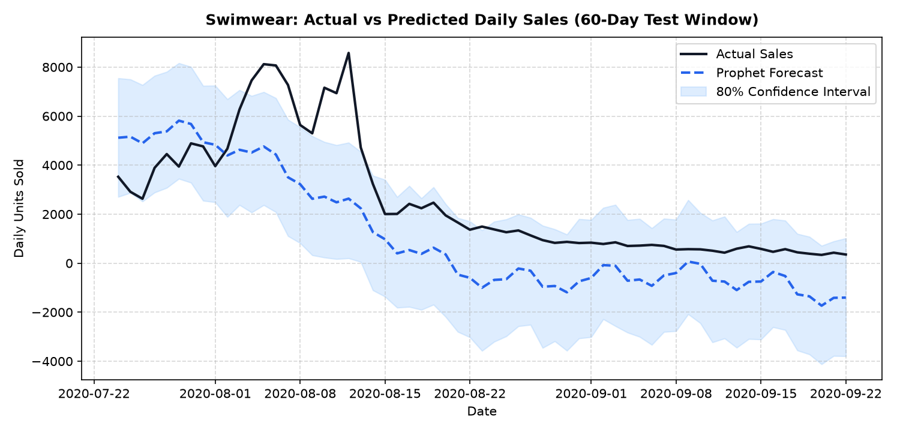
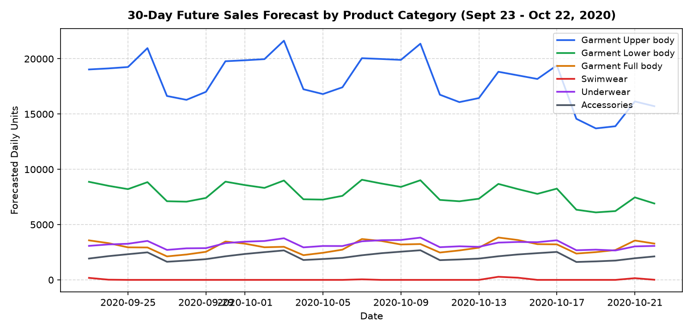

# hm-fashion-demand-forecasting

Time-series forecasting of H&M fashion sales using Python and Prophet.

## Preview

### Actual vs Predicted Sales (Swimwear Test Window)


### 30-Day Category Sales Forecast


## Overview

This project forecasts daily sales demand across top product categories from the [H&M Personalized Fashion Recommendations](https://www.kaggle.com/competitions/h-and-m-personalized-fashion-recommendations/data) Kaggle dataset. Using DuckDB for memory-efficient data processing and Prophet for time-series modelling, the pipeline analyses transaction patterns and evaluates demand predictions across seasonal and staple garment lines.

## Tools Used

- **Python**
- **Pandas**
- **DuckDB**
- **Prophet**
- **Jupyter Notebook**

## Project Structure

```text
hm-fashion-demand-forecasting/
├── assets/
│   ├── actual_vs_predicted.png
│   └── future_forecast.png
├── data/
│   ├── raw/                 # Download raw CSVs here (excluded from git)
│   └── processed/           # Generated daily sales datasets
├── notebooks/
│   ├── 01_data_understanding.ipynb
│   ├── 02_data_preparation.ipynb
│   └── 03_prophet_forecasting.ipynb
├── reports/
│   └── data_inspection.md
├── .gitignore
└── README.md
```

## How to Run

1. **Install dependencies:**
   ```bash
   pip install pandas numpy matplotlib duckdb prophet scikit-learn
   ```

2. **Download dataset:**
   Download `articles.csv` and `transactions_train.csv` from [Kaggle](https://www.kaggle.com/competitions/h-and-m-personalized-fashion-recommendations/data) and place them in `data/raw/` (raw files are not tracked in git due to size limits).

3. **Execute the notebooks in sequence:**
   - `notebooks/01_data_understanding.ipynb` — exploratory data analysis
   - `notebooks/02_data_preparation.ipynb` — aggregates transactions and builds `data/processed/daily_category_sales.csv`
   - `notebooks/03_prophet_forecasting.ipynb` — trains Prophet models, evaluates performance, and generates forecasts
